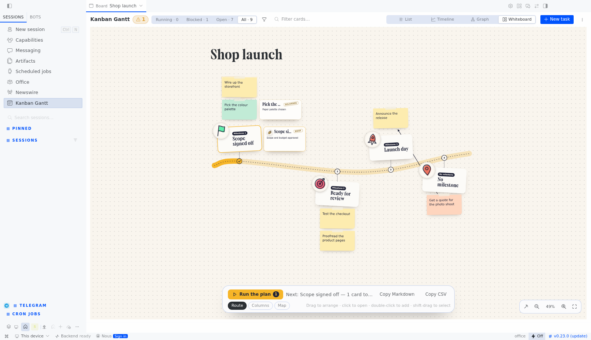

# Whiteboard view — a guide

The whiteboard is the fourth view of the plugin, next to List, Timeline and Graph. It shows the same
board as a plan on a wall: a road, stops, taped notes. Nothing is stored twice — every note is a
kanban card, and every action goes through the routes the task drawer already uses.



## Opening it

Click **Whiteboard** in the view switch, top right. The choice is remembered per page; the layout
(Route, Columns, Map) and everything you drag are remembered per board **and** per layout, so moving
a frame on the Map never rearranges the Route.

## The model, in one paragraph

A board is read as a sequence of **phases**. A phase is a **milestone** plus the cards that depend on
it. Cards that depend on nothing sit in a last, unnamed section ("No milestone"). A milestone is not a
special object: it is a card on the **`jalon`** lane — an assignee value the dispatcher never runs,
because it is not a profile. That is what makes the two views agree: the `◆ Jalon` badge on the
official board is the same fact, projected.

## Adding a milestone

Three ways, all writing the same thing (a card whose assignee is `jalon`):

1. **The button.** `+ New milestone`, in the bar at the bottom of the canvas. It opens the ordinary
   task form with **Assign** already set to `jalon`; type a title, create.
2. **The drawer.** Assign any existing card to `jalon` (the lane is offered with the profiles). Turn a
   finished checklist item into the gate of the next phase this way.
3. **The CLI**, for agents and scripts:

   ```bash
   hermes kanban --board <board> create "Launch day" --assignee jalon
   ```

**Where it lands.** Milestones are ordered by creation time, oldest first, and the road runs left to
right. A milestone you add is therefore **always the last stop** — the phase it opens is the end of
the plan. There is no "insert before": if you need one in the middle, create the milestones in the
order you want them, or rename/reorder at the board level (the whiteboard draws the order it is given
— it never renumbers by position on the canvas).

**A milestone holds nothing by itself.** Its phase is whatever *waits* for it (see the next section).
An empty milestone is a legitimate stop: it is a checkpoint you will pass by hand later.

## Putting work in a phase

- **Double-click the board.** A new card opens in the task form, with **Parent** set to the milestone
  of the phase you clicked in. That is the whole gesture: the card lands in that phase and the road
  knows it.
- **Drag a card onto its port.** Every card shows a small circle on its edge; dragging it onto another
  card makes the second one wait for the first. That is a real parent→child link, drawn as an arrow.
  Click an arrow to unlink it.
- **From the drawer or the CLI**, set the parent like any other kanban task.
- A card with no parent shows in the last section, "No milestone" — the loose work.

## Reading the canvas

- **Paper tone = stage**: butter is queued, sky is running (a breathing dot on the note), lilac is in review,
  peach is blocked, mint is done.
- **The road is gold up to the last milestone you passed**, then dashed. The numbered dots are the
  stops.
- **A finished card shows its result** on a "delivered" card beside it.
- **A passed milestone shows its brief**, postmarked, with the summary it was closed with.
- **An arrow means "waits for"**, drawn from the card that must finish first.
- **A running card carries its agent's cursor**, in the profile's colour.

## Acting on the plan

- **Hand to Hermes** (on a card behind an open gate): the first profile the gateway lists takes the
  card and it becomes `ready`, so the dispatcher runs it. A card that still waits for a prerequisite
  is never handed over — the whiteboard refuses and says so.
- **Run the plan** (bottom bar): it reads the road and does the next useful thing —
  - if the open phase has queued cards, it hands them over (the count is on the button);
  - if that phase is finished, it offers **Pass milestone** instead;
  - if the phase is at work, it says what it is waiting for.
- **Pass milestone**: completes the milestone card. Always a human's click — the lane is never
  dispatched. The completion carries a summary ("passed from the whiteboard"), because the board
  refuses a completion with no evidence.
- **Copy Markdown / Copy CSV**: the plan as text, for a ticket, a mail or a review.

## Arranging

| Gesture | Effect |
| --- | --- |
| Drag a note | Moves that card only |
| Drag a stop, frame or hub | Moves it **and** its notes |
| Shift-click / shift-drag on empty canvas | Adds to the selection, or draws a marquee |
| Drag one of several selected cards | Moves the whole selection |
| Wheel | Pans |
| Ctrl/⌘ + wheel | Zooms at the pointer |
| `+` / `−` / fit buttons, bottom right | Zoom, and fit the whole board |
| Tidy (wand, bottom right) | Forgets this layout's drags and re-lays the board out |
| Ctrl/⌘ + Z, Ctrl/⌘ + Shift + Z (or Ctrl + Y) | Undo, redo a drag or a tidy |
| Escape | Clears the selection, a pending link, an arrow pick |
| Double-click empty canvas | New card under that phase's milestone |

Positions are **local to this desktop** (browser storage, keyed by board and layout). They are not
synced to the gateway and do not travel with the board; "Tidy" is the way back.

## Limits worth knowing

- The whiteboard **adds no storage and no route**: no table, no new endpoint, no agent runtime of its
  own. What it cannot express through the drawer's routes, it does not do.
- A milestone is a card, so it can be renamed, described, given files, and found in every other view.
  Its only privilege is that it is never dispatched.
- Archived cards are hidden unless the board shows archived work.
- The road is a reading of dependencies, not a scheduler: it does not compute dates. Use the Timeline
  for that.
- Deleting a card (drawer) removes it from the plan as it removes it from the board.
